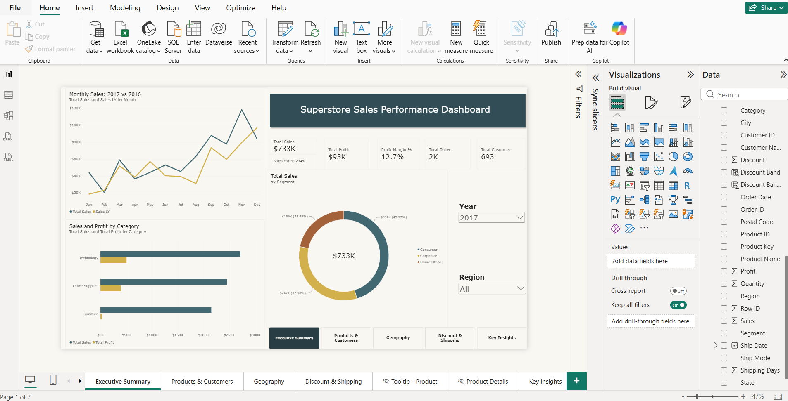
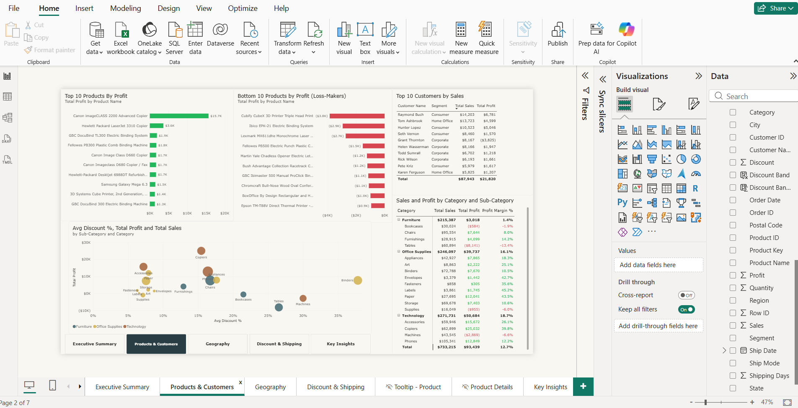
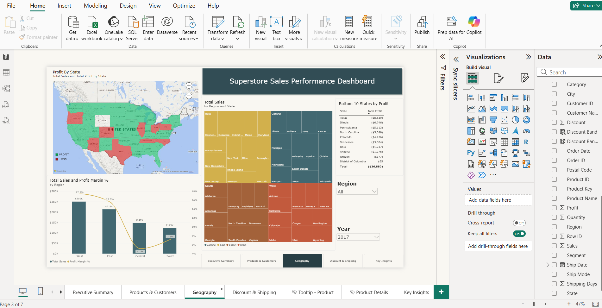
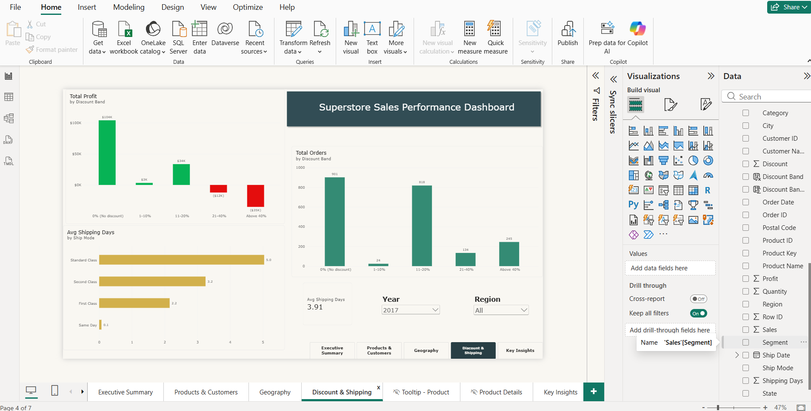
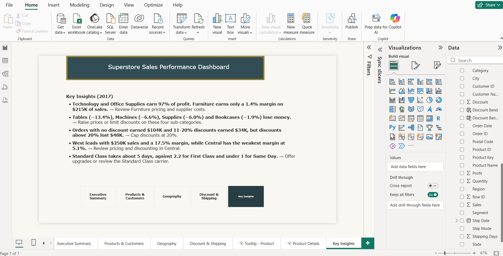

# Superstore Sales Performance Dashboard (Power BI)

An interactive Power BI dashboard analyzing sales, profit, discounts, customers, regional performance, and shipping operations for a US retail company.

**Dataset:** 9,994 orders | **Period:** 2014–2017

---

## Dashboard Preview

---

## Project Overview

This project focuses on analyzing retail sales data to identify business performance trends, profitability, customer behavior, product performance, and shipping efficiency.

The dashboard provides interactive visualizations and business insights to support data-driven decision-making.

## Tools & Technologies

- Microsoft Power BI Desktop
- Power Query
- DAX (Data Analysis Expressions)
- Data Modeling
- Data Visualization

## Dataset Information

- **Dataset:** Sample Superstore Dataset
- **Source:** Kaggle
- **Total Records:** 9,994 orders
- **Data Period:** 2014–2017
- **File Format:** CSV

Dataset file: `Sample_-_Superstore.csv`

## Project Objectives

- Analyze overall sales and profitability.
- Identify top-performing and loss-making products.
- Understand customer and regional sales performance.
- Evaluate the impact of discounts on profitability.
- Analyze shipping performance across different shipping modes.
- Develop an interactive dashboard for business insights.

## What I Did

### 1. Data Cleaning & Transformation

Performed data preparation using Power Query:

- Fixed date locale issues.
- Corrected data types.
- Trimmed unnecessary text spaces.
- Created Shipping Days and Product Key columns.
- Prepared the dataset for analysis.

### 2. Data Modeling

- Built a data model with a custom date table.
- Created dimension tables.
- Established relationships between tables.
- Organized the data model for efficient reporting.

### 3. DAX Measures

Created 15+ DAX measures, including:

- Total Sales
- Total Profit
- Profit Margin %
- Total Orders
- Total Customers
- Year-over-Year (YoY) Growth
- Year-to-Date (YTD) Analysis

### 4. Dashboard Development

Developed a five-page interactive Power BI dashboard with:

- Interactive slicers and filters.
- Drill-through functionality.
- Custom tooltips.
- Dashboard page navigation.
- KPI cards and interactive charts.

---

## Dashboard Pages & Screenshots

### 1. Executive Summary

Provides an overview of sales, profit, profit margin, orders, customers, and monthly sales trends.

### 2. Products & Customers

Analyzes top 10 profitable products, bottom 10 loss-making products, customer sales performance, and category-wise profitability.

### 3. Geography

Visualizes state-wise and regional sales performance, profit distribution, and regional profitability.

### 4. Discount & Shipping

Analyzes discount bands, profit performance, order distribution, and average shipping days by shipping mode.

### 5. Key Insights

Highlights important business findings and recommendations based on the analysis.

---

## Key Business Insights (2017)

- **Category Performance:** Technology and Office Supplies contribute approximately 97% of total profit, while Furniture has only a 1.4% profit margin.
- **Loss-Making Products:** Tables (-13.4%), Machines (-6.6%), Supplies (-6.0%), and Bookcases (-1.9%) generate negative profit margins.
- **Discount Impact:** Orders with no discount generated approximately $104K profit, while discounts above 20% resulted in approximately $48K losses.
- **Regional Performance:** West leads with a 17.5% profit margin, whereas Central has the weakest margin at 5.1%.
- **Shipping Performance:** Standard Class takes approximately 5 days, compared with 2.2 days for First Class.

## Project Downloads

Access the project files below:

- [Download Power BI Dashboard (.pbix)](Superstore_Sales_Dashboard.pbix)
- [View / Download PDF Report](Superstore_Sales_Dashboard.pdf)
- [Download Superstore Dataset (.csv)](Sample_-_Superstore.csv)

## How to Use This Project

1. Clone or download this GitHub repository.
2. Download the Power BI `.pbix` file.
3. Install Microsoft Power BI Desktop.
4. Open the downloaded PBIX file.
5. If necessary, update the CSV data source path in Power BI.
6. Refresh the dataset to explore the dashboard.

## Skills Demonstrated

- Data Analysis
- Data Cleaning & Transformation
- Power Query
- DAX Calculations
- Data Modeling
- Data Visualization
- Business Intelligence
- Interactive Dashboard Development

---

## Author

**GitHub:** [himanthk-03](https://github.com/himanthk-03)

*Developed as a practical Business Intelligence and Data Analytics portfolio project using Microsoft Power BI.*

---

**Thank you for visiting this project!**
